# Employee Attrition Problem Definition and Strategic Planning

[](https://www.python.org/)
[](LICENSE)
[](tests/test_data_validation.py)
[](https://www.python.org/dev/peps/pep-0008/)
[](data/README.md)

---

## 1. Project Overview & Academic Assignment Scope

This repository houses the formal academic and professional project for **Employee Attrition Problem Definition and Planning**.

In modern enterprise workforce management, unplanned employee turnover results in significant operational friction, direct recruitment expenditures, team burnout, and institutional memory depletion. 

The primary purpose of this project is to establish a rigorous, empirical, and ethically governed foundation for workforce retention analytics. Rather than hastily constructing black-box predictive models, this project focuses on:
- **Business Understanding & Problem Formulation**: Quantifying the multidimensional organizational impact of attrition and defining clear analytical research questions.
- **Dataset Understanding & Quality Auditing**: Documenting all 35 features of the verified IBM HR Analytics benchmark dataset, verifying 100% data completeness, and isolating non-predictive constants and identifiers.
- **Standardized Retention KPIs**: Formulating mathematically sound metrics for attrition and retention, clearly distinguishing static snapshot proportions from annualized turnover rates.
- **Basic Exploratory Data Analysis (EDA)**: Diagnosing key flight-risk drivers across functional job roles, overtime demands, compensation tiers, and employee sentiment ratings.
- **Ethics & Privacy Governance**: Establishing strict data minimization, auditing protected demographics (Age, Gender, Marital Status), and codifying an absolute prohibition on punitive automated employment decisions.
- **Project Roadmap & Architecture**: Establishing an Agile CRISP-DM engineering roadmap connecting current exploratory diagnostics to future Phase 2 predictive machine learning.

---

## 2. Formal Business Problem Statement

> **Core Formulation**:  
> *"Organizations experience operational disruption, recruitment costs, and knowledge loss when employees leave. Historical HR data can be examined to understand attrition patterns, define meaningful retention KPIs, and establish a responsible foundation for future attrition prediction."*

### Empirical Refinement (Based on Validated Benchmark Data)
Within the benchmark enterprise population of **1,470 employee records**, **237 departures (16.12%)** are observed, revealing acute organizational vulnerabilities:
- **Workload Fatigue**: Personnel working mandatory **OverTime** experience an attrition rate of **30.53%**, compared to **10.44%** among non-overtime staff (a **2.92x relative flight risk**).
- **Critical Role Vulnerability**: **Sales Representatives** experience the highest rate of turnover at **39.76%** ($n=33/83$), while **Laboratory Technicians** account for the largest single volume of departures (**62 departures**, representing **26.16% of all organizational turnover**).
- **Compensation & Tenure Disparity**: The median monthly salary of departing personnel is **$3,202**, compared to **$5,204** among retained staff (a **$2,002 / 38.5% deficit**), with departures concentrated during the early-career socialization window ($\le 3$ years of tenure).

*Full formal document*: [docs/business_problem_statement.md](docs/business_problem_statement.md)

---

## 3. Project Workflow Diagram

The project workflow enforces a disciplined two-phase lifecycle, segregating current diagnostic planning from future predictive modeling:

```mermaid
flowchart TD
    classDef currentPhase fill:#1e3d59,stroke:#17252a,stroke-width:2px,color:#ffffff,font-weight:bold;
    classDef futurePhase fill:#e8ecef,stroke:#6c757d,stroke-width:2px,stroke-dasharray: 5 5,color:#343a40,font-style:italic;
    classDef milestone fill:#d95f02,stroke:#8c3200,stroke-width:2px,color:#ffffff,font-weight:bold;

    subgraph PHASE1 ["PHASE 1: Problem Definition & Planning (Current Assignment)"]
        A["1. Business Understanding<br/>(HR Analytics & Business Case)"]:::currentPhase --> B["2. Stakeholder Analysis<br/>(Governance & Access Matrix)"]:::currentPhase
        B --> C["3. Dataset Acquisition<br/>(Verified IBM Benchmark)"]:::currentPhase
        C --> D["4. Dataset Validation<br/>(Completeness & Schema Audit)"]:::currentPhase
        D --> E["5. Feature Dictionary<br/>(35 Attributes & Taxonomies)"]:::currentPhase
        E --> F["6. Target Definition<br/>(Attrition Class & Imbalance)"]:::currentPhase
        F --> G["7. Business KPI Definition<br/>(Formulas, Nuances, Denominators)"]:::currentPhase
        G --> H["8. Basic Exploratory Data Analysis<br/>(Visualizations & Cross-Tabulations)"]:::currentPhase
        H --> I["9. Ethics & Privacy Review<br/>(Protected Demographics & Fairness)"]:::currentPhase
        I --> J["10. Problem Formulation<br/>(Scope, Hypotheses & Limitations)"]:::currentPhase
        J --> K["11. Project Roadmap<br/>(Gantt Schedule & Deliverables)"]:::currentPhase
        K --> L["12. GitHub Documentation<br/>(README, Reports & Codebase)"]:::currentPhase
    end

    subgraph PHASE2 ["PHASE 2: Advanced Predictive Modeling (Future Project Scope)"]
        M["13. Data Preprocessing & Encoding<br/>(One-Hot, Scaling, Resampling)"]:::futurePhase --> N["14. Baseline Model Selection<br/>(Logistic Regression, Decision Trees)"]:::futurePhase
        N --> O["15. Advanced Ensembles & Tuning<br/>(Random Forest, XGBoost, LightGBM)"]:::futurePhase
        O --> P["16. Model Explainability<br/>(SHAP, Feature Attribution)"]:::futurePhase
        P --> Q["17. Fairness Auditing<br/>(Disparate Impact & Equalized Odds)"]:::futurePhase
        Q --> R["18. Retention Decision Support<br/>(Ethical, Supportive Interventions)"]:::milestone
    end

    L ==> M
```



*High-resolution graphic*: [diagrams/project_workflow.png](diagrams/project_workflow.png)

---

## 4. Dataset Profile & Quality Summary

- **Dataset Name**: IBM HR Analytics Employee Attrition & Performance
- **Provenance / Origin**: IBM Watson Analytics Data Science Team
- **Public Domain License**: Creative Commons Public Domain Dedication (CC0 1.0 Universal) / Open Data Commons
- **Direct Acquisition URL**: `https://raw.githubusercontent.com/prernagoel/IBM-Employee-Attrition-Analysis-in-Python/master/WA_Fn-UseC_-HR-Employee-Attrition.csv`
- **Dimensions**: **1,470 rows** (employees) $\times$ **35 columns** (features)
- **Data Completeness**: **100.0% complete** across all 51,450 data cells (**0 missing values**)
- **Target Variable**: `Attrition` (`No`: 1,233 records [83.88%], `Yes`: 237 records [16.12%])
- **Class Imbalance Ratio**: **5.20 : 1**

### Feature Classification Taxonomy
1. **Target Feature (1)**: `Attrition` (Binary: Yes/No)
2. **Zero-Variance Constants (3)**: `EmployeeCount` (=1), `StandardHours` (=80), `Over18` (='Y') *(Excluded from modeling)*
3. **Primary Identifier (1)**: `EmployeeNumber` (1 to 2068) *(Excluded to prevent data leakage)*
4. **Protected Demographics (3)**: `Age`, `Gender`, `MaritalStatus` *(Subject to fairness auditing)*
5. **Subjective Sentiment (5)**: `EnvironmentSatisfaction`, `JobInvolvement`, `JobSatisfaction`, `RelationshipSatisfaction`, `WorkLifeBalance` (1–4 Likert scales)
6. **Tenure & Mobility (5)**: `TotalWorkingYears`, `YearsAtCompany`, `YearsInCurrentRole`, `YearsSinceLastPromotion`, `YearsWithCurrManager`
7. **Compensation & Equity (6)**: `DailyRate`, `HourlyRate`, `MonthlyIncome`, `MonthlyRate`, `PercentSalaryHike`, `StockOptionLevel`
8. **Work Conditions & Demands (3)**: `BusinessTravel`, `DistanceFromHome`, `OverTime`
9. **Role & Qualifications (8)**: `Department`, `JobRole`, `JobLevel`, `Education`, `EducationField`, `NumCompaniesWorked`, `PerformanceRating`, `TrainingTimesLastYear`

*Full feature dictionary*: [docs/feature_dictionary.md](docs/feature_dictionary.md) | [outputs/tables/feature_dictionary.csv](outputs/tables/feature_dictionary.csv)

---

## 5. Key Exploratory Data Analysis (EDA) Findings

All analytical findings are computed strictly from dataset observations:

```
┌────────────────────────────────────────────────────────────────────────┐
│                   KEY DIAGNOSTIC FINDINGS SUMMARY                      │
├──────────────────────────┬─────────────────────┬───────────────────────┤
│ Dimension                │ Metric / Statistic  │ Business Interpretation│
├──────────────────────────┼─────────────────────┼───────────────────────┤
│ Overall Population       │ N = 1,470 records   │ 237 departures        │
│ Attrition Proportion     │ 16.12% (No: 83.88%) │ 5.2:1 class imbalance │
├──────────────────────────┼─────────────────────┼───────────────────────┤
│ Overtime Impact          │ Yes: 30.53% rate    │ Overtime staff face   │
│                          │ No:  10.44% rate    │ 2.92x flight risk     │
├──────────────────────────┼─────────────────────┼───────────────────────┤
│ Highest Attrition Role   │ Sales Representative│ Entry sales face      │
│                          │ 39.76% (n=33/83)    │ quota / churn strain  │
├──────────────────────────┼─────────────────────┼───────────────────────┤
│ Highest Volume Role      │ Laboratory Tech     │ Technical backbone    │
│                          │ 23.94% (n=62/259)   │ = 26.2% all departures│
├──────────────────────────┼─────────────────────┼───────────────────────┤
│ Monthly Compensation     │ Retained: $5,204    │ Departed earn 38.5%   │
│ (Median Income)          │ Departed: $3,202    │ lower base pay        │
├──────────────────────────┼─────────────────────┼───────────────────────┤
│ Organizational Tenure    │ Retained: 6.0 yrs   │ Departures concentrated│
│ (Median Company Years)   │ Departed: 3.0 yrs   │ in years 0–3 window   │
├──────────────────────────┼─────────────────────┼───────────────────────┤
│ Job Satisfaction (1 vs 4)│ Low:  22.84% rate   │ Low satisfaction      │
│                          │ High: 11.33% rate   │ doubles flight risk   │
└──────────────────────────┴─────────────────────┴───────────────────────┘
```

*Generated Visualization Artifacts*:
- [Attrition Distribution Donut & Bar Chart](outputs/figures/attrition_distribution.png)
- [Job Role Attrition Risk Profile](outputs/figures/attrition_by_job_role.png)
- [OverTime vs. Attrition Rate](outputs/figures/attrition_by_overtime.png)
- [Income and Tenure Boxplots](outputs/figures/tenure_and_income_distributions.png)
- [Satisfaction Likert Scale Breakdown](outputs/figures/satisfaction_and_wlb_attrition.png)
- [Pearson Correlation Matrix Heatmap](outputs/figures/correlation_heatmap.png)

---

## 6. Enterprise Retention KPIs Catalog Summary

The project formalizes 9 enterprise retention KPIs detailed in [docs/business_kpis.md](docs/business_kpis.md):
1. **Overall Attrition Rate (%)**: $\left(\frac{\text{Departures during period}}{\text{Average active headcount}}\right) \times 100$. *(Dataset sample proportion: **16.12%**; not to be mislabeled as an annual rate).*
2. **Overall Retention Rate (%)**: $\left(\frac{\text{Retained active personnel}}{\text{Opening headcount}}\right) \times 100$. *(Dataset sample proportion: **83.88%**).*
3. **Voluntary Attrition Rate (%)**: Requires separation reason classification (`Resignation` vs `Discharge`).
4. **Department & Role-Disaggregated Attrition (%)**: Always reporting both rate and absolute headcount share.
5. **Average Tenure**: Measuring company tenure (departed median: 3.0 yrs) and manager tenure (departed median: 2.0 yrs).
6. **Employee Sentiment Index**: Composite favorable score across 5 Likert survey dimensions.
7. **Critical Role Attrition Rate (%)**: Specialized turnover tracking in designated high-impact roles.
8. **Total Replacement Cost ($)**: Benchmark heuristic estimating turnover cost at $0.50 \times \text{Annual Base Salary}$ ($\approx \$28,722$ per departure).
9. **Machine Learning Performance Metrics vs. Business KPIs**: Clear distinction between mathematical validation metrics (Precision, Recall, F1, ROC-AUC) and true real-world business retention impact.

---

## 7. Ethical Governance & Strict Non-Punitive Clause

Workforce analytics handles personal human data. This project enforces an **absolute prohibition on punitive actions**:

```
🛑 STRICT PROHIBITION MANDATE:
Predictive flight-risk scores or exploratory diagnostics MUST NEVER be used as the 
basis for termination, disciplinary action, promotion denial, or salary reductions.
Permitted use is strictly confined to supportive, systemic interventions: workload 
rebalancing, leadership training, compensation adjustments, and early-career mentorship.
```

- **Protected Demographics**: Strict audits across `Age` (ADEA compliance), `Gender` (Title VII), and `MaritalStatus`.
- **Data Minimization & RBAC**: Direct identifiers (`EmployeeNumber`) stripped from analytical tables. Frontline managers are strictly denied access to raw flight-risk scores for direct reports.
- **Explainability**: Black-box predictions are barred; local and global SHAP attribution is mandatory.

*Full Ethics Report*: [docs/ethics_report.md](docs/ethics_report.md) | [reports/ethics_report.pdf](reports/ethics_report.pdf)

---

## 8. Repository Structure

```text
employee-attrition-problem-definition-planning/
├── README.md                                   # Comprehensive master project documentation
├── requirements.txt                            # Verified locked Python package dependencies
├── .gitignore                                  # Git exclusion configuration (caches, environments)
├── LICENSE                                     # Open-source MIT License
├── docs/
│   ├── business_problem_statement.md           # 13-section formal business problem statement
│   ├── stakeholder_analysis.md                 # Stakeholder matrix, RBAC tiers & retention strategies
│   ├── feature_dictionary.md                   # Column-by-column dictionary for all 35 features
│   ├── business_kpis.md                        # Enterprise retention KPI catalog & formulas
│   ├── ethics_report.md                        # Ethics, privacy safeguards & pre-deployment checklist
│   └── project_roadmap.md                      # Gantt timeline, dependencies & task breakdown
├── data/
│   ├── README.md                               # Dataset provenance, CC0 license & schema documentation
│   └── WA_Fn-UseC_-HR-Employee-Attrition.csv   # Verified IBM HR Analytics benchmark dataset
├── notebooks/
│   └── employee_attrition_problem_definition.ipynb # Fully executed Jupyter Notebook
├── reports/
│   ├── dataset_report.pdf                      # 7-page executive dataset profiling report
│   └── ethics_report.pdf                       # 5-page formal ethics and governance report
├── diagrams/
│   ├── project_workflow.mmd                    # Editable Mermaid architecture workflow source
│   └── project_workflow.png                    # 300 DPI high-resolution rendered diagram
├── outputs/
│   ├── figures/                                # High-resolution publication charts (PNG)
│   │   ├── attrition_distribution.png
│   │   ├── attrition_by_department.png
│   │   ├── attrition_by_job_role.png
│   │   ├── attrition_by_overtime.png
│   │   ├── tenure_and_income_distributions.png
│   │   ├── satisfaction_and_wlb_attrition.png
│   │   ├── correlation_heatmap.png
│   │   └── missing_values_summary.png
│   └── tables/                                 # Summary cross-tabulation exports (CSV)
│       ├── feature_dictionary.csv
│       ├── attrition_by_department.csv
│       ├── attrition_by_job_role.csv
│       ├── attrition_by_overtime.csv
│       ├── attrition_by_job_satisfaction.csv
│       ├── attrition_by_work_life_balance.csv
│       └── attrition_by_marital_status.csv
├── scripts/                                    # Reproducible automation scripts
│   ├── generate_feature_dictionary.py
│   ├── generate_eda_visualizations.py
│   ├── build_notebook.py
│   ├── render_workflow_diagram.py
│   ├── generate_ethics_pdf.py
│   └── generate_dataset_pdf.py
└── tests/
    └── test_data_validation.py                 # Automated pytest validation suite (12 tests)
```

---

## 9. Environment Setup and Reproducibility

This project is built and validated for **Python 3.11** on Windows, macOS, and Linux.

### Windows PowerShell Setup Instructions

```powershell
# 1. Clone or navigate to the repository directory
cd "d:\Project 1"

# 2. Create a clean virtual environment
python -m venv .venv

# 3. Activate the virtual environment
.venv\Scripts\Activate.ps1

# 4. Upgrade pip
python -m pip install --upgrade pip

# 5. Install locked dependencies
pip install -r requirements.txt

# 6. Execute the automated validation test suite
python -m pytest tests/test_data_validation.py -v

# 7. Launch Jupyter Notebook to review interactive analysis
jupyter notebook notebooks/employee_attrition_problem_definition.ipynb
```

### Headless Reproduction of All Figures & PDF Reports

To reproduce all figures, tables, executed notebooks, and PDF reports headlessly from the command line:

```powershell
python scripts/generate_feature_dictionary.py
python scripts/generate_eda_visualizations.py
python scripts/render_workflow_diagram.py
python scripts/generate_ethics_pdf.py
python scripts/generate_dataset_pdf.py
python -m nbconvert --to notebook --execute --inplace notebooks/employee_attrition_problem_definition.ipynb
```

---

## 10. Quality Assurance & Automated Test Results

The project includes an automated test suite executed via `pytest`:
- `test_dataset_exists_and_loads`: Validates file presence and DataFrame loading.
- `test_dataset_dimensions`: Verifies canonical dimensions (1,470 rows $\times$ 35 columns).
- `test_target_variable`: Validates target classes (`No`: 1,233, `Yes`: 237; 16.12% rate).
- `test_no_missing_values`: Validates 100% data completeness (0 nulls).
- `test_no_duplicate_rows`: Confirms 0 duplicate records.
- `test_constant_columns_identified`: Verifies `EmployeeCount`=1, `StandardHours`=80, `Over18`='Y'.
- `test_employee_number_uniqueness`: Confirms `EmployeeNumber` uniqueness across all 1,470 rows.
- `test_feature_dictionary_completeness`: Confirms dictionary covers all 35 columns.
- `test_generated_figures_exist`: Confirms all 8 visualization PNGs exist and are non-empty.
- `test_workflow_diagram_exists`: Confirms `.mmd` source and rendered `.png` diagram.
- `test_pdf_reports_exist`: Validates compilation of `dataset_report.pdf` and `ethics_report.pdf`.
- `test_documentation_files_exist`: Verifies all mandatory markdown documentation files exist.

```text
============================= test session starts =============================
platform win32 -- Python 3.11.0, pytest-9.1.1, pluggy-1.6.0
rootdir: D:\Project 1
collected 12 items

tests/test_data_validation.py::test_dataset_exists_and_loads PASSED      [  8%]
tests/test_data_validation.py::test_dataset_dimensions PASSED            [ 16%]
tests/test_data_validation.py::test_target_variable PASSED               [ 25%]
tests/test_data_validation.py::test_no_missing_values PASSED             [ 33%]
tests/test_data_validation.py::test_no_duplicate_rows PASSED             [ 41%]
tests/test_data_validation.py::test_constant_columns_identified PASSED   [ 50%]
tests/test_data_validation.py::test_employee_number_uniqueness PASSED    [ 58%]
tests/test_data_validation.py::test_feature_dictionary_completeness PASSED [ 66%]
tests/test_data_validation.py::test_generated_figures_exist PASSED       [ 75%]
tests/test_data_validation.py::test_workflow_diagram_exists PASSED       [ 83%]
tests/test_data_validation.py::test_pdf_reports_exist PASSED             [ 91%]
tests/test_data_validation.py::test_documentation_files_exist PASSED     [100%]

============================= 12 passed in 0.80s ==============================
```

---

## 11. GitHub Submission Instructions

To publish this project cleanly to GitHub:

### Step 1: Initialize Git and Stage Local Files
```powershell
cd "d:\Project 1"
git status
git add .
git commit -m "feat: complete employee attrition problem definition, EDA, and planning baseline"
```

### Step 2: Create a New Repository on GitHub
1. Log into your personal GitHub account at [https://github.com](https://github.com).
2. Click the **New** repository button.
3. Repository name: `employee-attrition-problem-definition-planning`.
4. Description: *"Employee Attrition Problem Definition, Exploratory Analytics, Business KPIs, Ethics Governance, and Planning Baseline"*.
5. Set visibility to **Public** (or **Private** as required by your academic instructor).
6. **Important**: Leave "Initialize with README", ".gitignore", and "License" **unchecked** (we have already created them locally).
7. Click **Create repository**.

### Step 3: Link Remote and Push
Copy your actual repository URL from GitHub (e.g., `https://github.com/<your-username>/employee-attrition-problem-definition-planning.git`) and run:

```powershell
git remote add origin https://github.com/<your-username>/employee-attrition-problem-definition-planning.git
git branch -M main
git push -u origin main
```

*(Note: Per git safety guidelines, remote push commands must be executed using your verified personal GitHub credentials).*

---

## 12. Academic Attribution & References

1. **IBM Watson Analytics** (2015). *HR Employee Attrition and Performance Dataset*. Synthetic benchmark for HR predictive analytics.
2. **Cascio, W. F., & Boudreau, J. W.** (2016). *Investing in People: Financial Impact of Human Resource Initiatives*. Pearson Education.
3. **Lundberg, S. M., & Lee, S. I.** (2017). *A Unified Approach to Interpreting Model Predictions (SHAP)*. Advances in Neural Information Processing Systems (NeurIPS 2017).
4. **Equal Employment Opportunity Commission (EEOC)**. *Uniform Guidelines on Employee Selection Procedures*. 29 CFR Part 1607.
5. **European Union**. *General Data Protection Regulation (GDPR)*, Regulation (EU) 2016/679, Articles 5, 6, 9, and 22.
