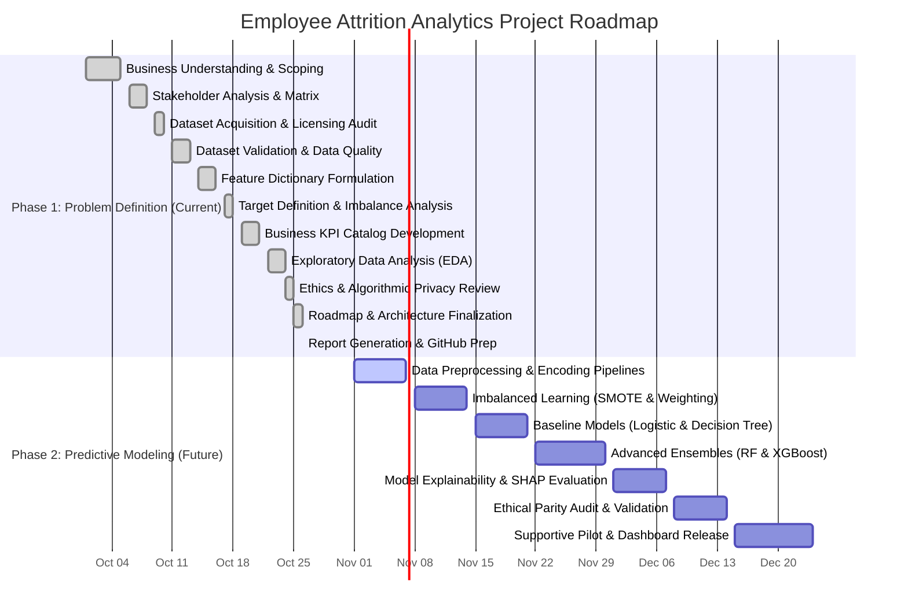

# Project Roadmap: Employee Attrition Problem Definition and Planning

**Document Version**: 1.0  
**Project Phase**: Phase 1 (Baseline Problem Formulation) Completed; Phase 2 (Predictive Modeling) Scheduled  
**Methodology**: Agile Data Science Lifecycle / CRISP-DM Adapted for People Analytics  

---

## 1. Roadmap Overview & Phased Strategy

The **Employee Attrition Analytics** initiative is divided into two distinct, sequential phases:
- **Phase 1: Problem Definition, Diagnostic EDA, and Governance (Current Assignment Scope)**:
  Focuses on establishing business clarity, auditing dataset hygiene, standardizing retention KPIs, exploring empirical patterns, and codifying ethical boundaries.
- **Phase 2: Advanced Machine Learning & Predictive Retention Modeling (Future Project Scope)**:
  Focuses on algorithm benchmarking, hyperparameter optimization, class-imbalance treatment, SHAP explainability, and integration into decision-support toolkits.

```
┌─────────────────────────────────────────────────────────────────────────┐
│                       STRATEGIC ROADMAP LIFECYCLE                       │
├─────────────────────────────────────────┬───────────────────────────────┤
│    PHASE 1: Problem Definition & EDA    │   PHASE 2: Predictive Models  │
│          (CURRENT - COMPLETED)          │        (FUTURE - PLANNED)     │
├─────────────────────────────────────────┼───────────────────────────────┤
│ • Business Understanding & Objectives   │ • Advanced Feature Preprocessing│
│ • Stakeholder Analysis & Governance     │ • Stratified Splitting & SMOTE│
│ • Dataset Profiling (35 features)       │ • Algorithm Benchmarking      │
│ • Comprehensive Feature Dictionary      │ • Hyperparameter Optimization │
│ • Business Retention KPIs Specification │ • SHAP Attribution & Explain. │
│ • Diagnostic Exploratory Data Analysis  │ • Bias Auditing & Mitigation  │
│ • Ethical Framework & Non-Punitive Rule │ • Supportive Retention Pilot  │
│ • Academic Reports & GitHub Repository  │ • Continuous Model Monitoring │
└─────────────────────────────────────────┴───────────────────────────────┘
```

---

## 2. Visual Project Timeline (Mermaid Gantt Chart)



---

## 3. Comprehensive Task Breakdown Matrix

| Phase ID | Phase Name | Primary Tasks & Activities | Dependencies | Estimated Effort | Deliverables & Artifacts | Status |
| :---: | :--- | :--- | :--- | :---: | :--- | :---: |
| **P1.1** | **Business Understanding** | - Articulate business case for retention.<br>- Differentiate voluntary vs involuntary attrition.<br>- Quantify operational impact of turnover. | None | 12 Hours | `docs/business_problem_statement.md` | **Completed** |
| **P1.2** | **Stakeholder Analysis** | - Map 9 organizational stakeholder groups.<br>- Establish role-based access control (RBAC).<br>- Link diagnostic factors to retention strategies. | P1.1 | 10 Hours | `docs/stakeholder_analysis.md` | **Completed** |
| **P1.3** | **Dataset Acquisition** | - Acquire verified IBM HR Analytics dataset.<br>- Verify public domain CC0 licensing.<br>- Audit file integrity and data provenance. | P1.1 | 4 Hours | `data/WA_Fn-UseC_-HR-Employee-Attrition.csv`<br>`data/README.md` | **Completed** |
| **P1.4** | **Dataset Validation** | - Verify row (1,470) and column (35) counts.<br>- Check missing values (0 found).<br>- Identify zero-variance constants & ID feature. | P1.3 | 6 Hours | Data validation scripts & test suite | **Completed** |
| **P1.5** | **Feature Dictionary** | - Document all 35 dataset attributes.<br>- Classify data types, measurement scales.<br>- Tag analytical roles and ethical notes. | P1.4 | 14 Hours | `docs/feature_dictionary.md`<br>`outputs/tables/feature_dictionary.csv` | **Completed** |
| **P1.6** | **Target Definition** | - Validate binary target `Attrition`.<br>- Quantify class imbalance (237 Yes, 1233 No).<br>- Document ~5.2:1 class imbalance ratio. | P1.4 | 4 Hours | Section 5 of Problem Statement | **Completed** |
| **P1.7** | **Business KPIs** | - Standardize 9 enterprise retention KPIs.<br>- Detail numerators, denominators, reporting.<br>- Highlight static snapshot vs annual turnover. | P1.5, P1.6 | 12 Hours | `docs/business_kpis.md` | **Completed** |
| **P1.8** | **Exploratory Data Analysis** | - Develop reproducible Jupyter notebook.<br>- Analyze department, role, overtime, pay.<br>- Plot boxplots, distributions, and correlation heatmap. | P1.5, P1.7 | 18 Hours | `notebooks/employee_attrition_problem_definition.ipynb`<br>`outputs/figures/*.png` | **Completed** |
| **P1.9** | **Ethics & Privacy Review** | - Audit protected demographics (Age, Gender, Marital Status).<br>- Codify prohibition on punitive automated actions.<br>- Create pre-deployment ethics checklist. | P1.8 | 12 Hours | `docs/ethics_report.md`<br>`reports/ethics_report.pdf` | **Completed** |
| **P1.10** | **Project Workflow Diagram** | - Create 18-step architecture diagram.<br>- Distinguish Phase 1 vs Phase 2 scopes.<br>- Export editable Mermaid and 300 DPI PNG. | P1.9 | 6 Hours | `diagrams/project_workflow.mmd`<br>`diagrams/project_workflow.png` | **Completed** |
| **P1.11** | **Dataset Report** | - Compile comprehensive 18-section PDF report.<br>- Embed computed statistics, tables, and charts. | P1.8, P1.10 | 14 Hours | `reports/dataset_report.pdf` | **Completed** |
| **P1.12** | **GitHub Repository Prep** | - Configure `.gitignore`, `requirements.txt`, `LICENSE`.<br>- Author master `README.md`.<br>- Implement automated pytest test suite. | All P1 Tasks | 10 Hours | Full repository structure,<br>`tests/test_data_validation.py` | **Completed** |
| **P2.1** | **Data Preprocessing** | - Implement column transformers (One-Hot, Scalers).<br>- Construct leak-free pipeline architecture. | P1.12 | 16 Hours | `src/preprocessing.py` | *Future* |
| **P2.2** | **Resampling & Splitting** | - Execute stratified train/test partitioning (70/15/15).<br>- Benchmark SMOTE, ADASYN, and class weighting. | P2.1 | 12 Hours | `src/data_split.py` | *Future* |
| **P2.3** | **Baseline Modeling** | - Train Logistic Regression & Decision Trees.<br>- Compute baseline Precision, Recall, PR-AUC. | P2.2 | 16 Hours | `notebooks/02_baseline_models.ipynb` | *Future* |
| **P2.4** | **Ensembles & Tuning** | - Train Random Forest, XGBoost, LightGBM.<br>- Bayesian hyperparameter tuning with 5-fold CV. | P2.3 | 24 Hours | `src/model_training.py` | *Future* |
| **P2.5** | **Explainability (SHAP)** | - Extract TreeSHAP global and local values.<br>- Generate summary plots and force plots. | P2.4 | 14 Hours | `reports/model_explainability.pdf` | *Future* |
| **P2.6** | **Fairness Audit** | - Audit disparate impact and equalized odds.<br>- Validate fairness across Age, Gender, Marital Status. | P2.5 | 16 Hours | `reports/fairness_audit.pdf` | *Future* |
| **P2.7** | **Retention Support Tool** | - Build internal HR dashboard for supportive interventions.<br>- Establish continuous monitoring for model drift. | P2.6 | 30 Hours | Retention Decision Support App | *Future* |

---

## 4. Dependencies, Milestones, and Completion Criteria

### Phase 1 Completion Milestone (Achieved)
- **Criterion 1**: 100% of dataset attributes documented in feature dictionary without missingness.
- **Criterion 2**: Fully reproducible Jupyter notebook executing from beginning to end with verified zero execution errors.
- **Criterion 3**: High-resolution workflow diagrams and executive PDF reports published.
- **Criterion 4**: Automated test suite passing with 100% success rate.
- **Criterion 5**: Formal ethics framework codified, explicitly prohibiting punitive employment actions based on predictive scores.
